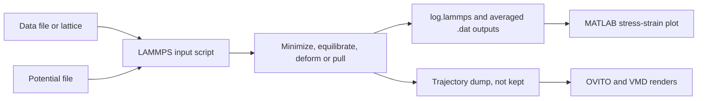

# Molecular Dynamics Tutorials in LAMMPS

Six molecular-dynamics exercises in LAMMPS: compressing an aluminum crystal, deforming silica with a reactive force field, shearing an electrolyte between walls, stretching a polymer in water, pulling a carbon nanotube apart, and stretching amorphous polyethylene. Self-study, July to August 2024, working through published LAMMPS tutorials (see Credits), with every input command annotated in my own words.

This repository is a project showcase, not a maintained library.

## Demo

![Stress-strain curve of the 108,000-atom aluminum crystal compressed along [100] at 300 K: the axial stress rises linearly to a peak of about 6 GPa near 10% strain, drops sharply to about 1.3 GPa as the crystal yields, and stays there to 20% strain; the two lateral stresses stay near zero](01-aluminum-compression/108000-atoms-300K/Plot/StressStrainPlot.png)

Uniaxial compression of a 108,000-atom aluminum crystal at 300 K, plotted with [`StressStrainPlot.m`](01-aluminum-compression/108000-atoms-300K/Plot/StressStrainPlot.m). Red is the stress along the loading direction; blue and green are the two lateral stresses, held near zero by the barostat.

No video is linked yet. The trajectories were rendered in OVITO and VMD; the renders and the trajectory files are not kept here (see Development).

## Features

| Exercise | What it simulates | Force field and method |
|---|---|---|
| [`01-aluminum-compression`](01-aluminum-compression) | An FCC aluminum single crystal compressed along [100] to 20% strain at 10<sup>10</sup> s<sup>-1</sup>, run four times: 32,000 and 108,000 atoms, at 10 K and 300 K | EAM (Mishin et al. 1999); NPT equilibration, then `fix deform` with the lateral faces at zero pressure |
| [`02-reactive-silica`](02-reactive-silica) | Amorphous silica made by melting at 6000 K and quenching to 300 K, then relaxed and stretched while its Si-O bonds are tracked | Vashishta for the melt-quench; ReaxFF with charge equilibration and bond-species tracking for the deformation |
| [`03-nanosheared-electrolyte`](03-nanosheared-electrolyte) | Water with 15 cations and 15 anions confined between two walls, built, minimized, equilibrated and then sheared by moving the walls in opposite directions | TIP4P water with SHAKE, long-range electrostatics (PPPM); density profiles of water, ions and walls |
| [`04-polymer-in-water`](04-polymer-in-water) | A PEG chain merged into water, equilibrated, then pulled by its ends | SPC/Fw water, GROMOS PEG, PPPM; end-to-end distance and radius of gyration over time |
| [`05-carbon-nanotube`](05-carbon-nanotube) | A carbon nanotube stretched along its axis: with permanent bonds both ends are pulled apart; with bonds that can break, one end is pulled while the other is held | Harmonic bonds with Lennard-Jones (unbreakable); AIREBO (breakable) |
| [`06-amorphous-polyethylene`](06-amorphous-polyethylene) | A united-atom polyethylene glass (10 chains of 1,000 units) cooled from the melt and stretched | Dreiding bonded terms with Lennard-Jones; Langevin and NPT cooling, then uniaxial deformation |

**What the aluminum runs show** (from the `Al_comp_100.def1.txt` files): the peak compressive stress is 8.30 GPa at 10 K for both sizes, and 6.00 GPa (32,000 atoms) and 6.07 GPa (108,000 atoms) at 300 K. Temperature lowers the yield stress by about 27%, while tripling the number of atoms changes it by about 1%.

## Installation and getting started

Prerequisites: [LAMMPS](https://www.lammps.org/download.html). The logs were produced by the Windows builds of LAMMPS 2 Aug 2023 (exercises 1 and 5) and 27 Jun 2024 (the rest); several exercises need packages beyond the core (REAXFF, MANYBODY, MOLECULE, KSPACE), which those builds had. Optional: [OVITO](https://www.ovito.org) or [VMD](https://www.ks.uiuc.edu/Research/vmd/) to view trajectories, and MATLAB for the aluminum plot.

```bash
git clone https://github.com/naimulnashid/lammps-md-tutorials.git
```

The aluminum exercise needs one file that is not included: download `Al99.eam.alloy` from the [NIST Interatomic Potentials Repository](https://www.ctcms.nist.gov/potentials/entry/1999--Mishin-Y-Farkas-D-Mehl-M-J-Papaconstantopoulos-D-A--Al/) and put a copy in the run folder you want to run. Every other potential and data file is in its exercise folder.

## Configuration

No configuration needed. Temperatures, strain rates, forces and run lengths are variables at the top of each input script.

## Usage

Run each input from its own folder, because the scripts read their data and potential files by relative path:

```bash
cd 01-aluminum-compression/108000-atoms-300K
lmp -in in.comp.txt
```

Multi-step exercises run in order, each step reading the previous step's output file: `SilicaBlock`, `1_RelaxSilica` then `2_Deform` for silica; `1_systemcreation` to `4_shearing` for the electrolyte; `1_pureH2O` to `3_pullonPEG` for the polymer. Each folder keeps the `log.lammps` and the averaged outputs (`.dat`, `.txt`) of my run, so the results can be read without running anything. On Windows the executable may be named `lmp` or `lmp_serial`, depending on the installer.

The `VMD` folders hold the VMD visualization states I used; open one after loading the matching trajectory.

## Tech stack and architecture

LAMMPS input scripts, LAMMPS data files and potential files, VMD state scripts and one MATLAB plotting script.



## Security and privacy

Input and output files only. Nothing runs on its own or connects anywhere. Local folder paths in the logs and VMD states are shown with `<user>` in place of the Windows user name.

## Development

The project is complete and not under development. This repository was made on 2026-11-22 from an earlier one of mine that held 2.5 GB of trajectory dumps, renders and restart files. Only the inputs, data and potential files, logs, averaged outputs, VMD states and the plot were kept. One path was fixed so the silica deformation finds its force field (`../1_RelaxSilica/reaxCHOFe.ff`, previously `../RelaxSilica/`). The inputs were not re-run for this repository.

## Credits, license and support

- Exercises 1 and 6 follow Mark Tschopp's LAMMPS tutorials on the Mississippi State University ICME wiki: [Uniaxial Compression](https://icme.hpc.msstate.edu/mediawiki/index.php/Uniaxial_Compression.html) (the input header credits "Mark Tschopp, November 2010") and [Atomistic Deformation of Amorphous Polyethylene](https://icme.hpc.msstate.edu/mediawiki/index.php/MD_PE_deformation.html) by Tschopp, Hossain and Horstemeyer.
- Exercises 2 to 5 follow Simon Gravelle's [LAMMPS Tutorials](https://lammpstutorials.github.io), described in S. Gravelle, J. R. Gissinger and A. Kohlmeyer, "[A Set of Tutorials for the LAMMPS Simulation Package](https://arxiv.org/abs/2503.14020)". Their files are under CC BY 4.0.
- The ReaxFF, Vashishta and AIREBO parameter files are the ones distributed with LAMMPS (GPL-2.0). `Al99.eam.alloy` is by Y. Mishin et al. (1999), from NIST.
- No license is granted for my own files in this repository: they are shared to show the work, not for reuse.
- This is a personal showcase, so issues and pull requests are not monitored.
